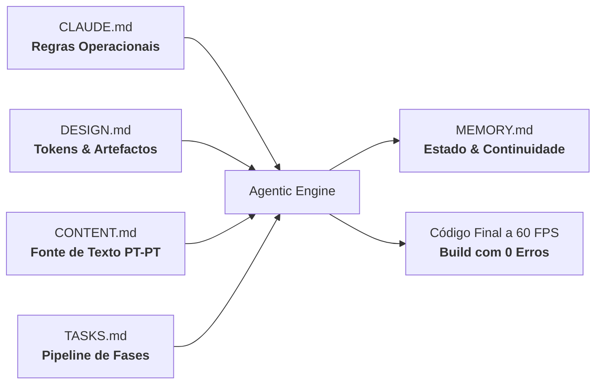

# Mise — Receitas com IA a partir da tua despensa

<p align="center">
  
</p>

<p align="center">
  <strong>Mise en place na tua cozinha: uma brigada inteligente que cria receitas com o que realmente tens em casa e diz-te, com rigor e honestidade, o que te falta.</strong>
</p>

<p align="center">
  
  
  
  
  
  
  
</p>

---

## 🗂️ Estrutura do Monorepo

```text
mise-recipe-agents/
├── landing/    # Landing page cinematográfica & editorial de alta fidelidade + web app para testar
└── backend/        # Aplicação interativa em Python (CrewAI + FastAPI) [Em breve]

```

---

## 🍽️ Landing Page (`landing/`)

A landing page do **Mise** não é uma página genérica de SaaS ou inteligência artificial. Foi concebida como uma experiência sensorial e tátil onde o **caderno de receitas de uma tasca portuguesa contemporânea encontra uma mesa de comando de alta precisão**.

> **Direção de Arte:** Papel quente de alta gramagem, carimbos físicos com textura de borracha, fita-crepe de cozinheiro (*chef masking tape*), tipografia editorial e ausência deliberada de clichés sintéticos de IA.

---

### ⚡ Metodologia de Desenvolvimento: Agentic Vibe Coding & CDD

Este projeto foi construído do zero através de **Agentic Vibe Coding** de alta precisão, sustentado por **Context-Driven Development (CDD)**. Em vez de prompts caóticos, o desenvolvimento foi orquestrado por um ecossistema de especificação canónica em Markdown:



- **`CLAUDE.md`** — Leis operacionais inegociáveis: respeito estrito a `prefers-reduced-motion`, proibição de dados inventados e validação obrigatória de compilação em cada fase.
- **`DESIGN.md`** — Paleta cromática autêntica (`--paper`, `--ink`, `--tomato`, `--olive`, `--saffron`), tokens de física de mola e princípios de *Human Craft*.
- **`CONTENT.md`** — Única fonte da verdade para toda a cópia em rigoroso **Português de Portugal**.
- **`TASKS.md`** — Roteiro faseado executado de forma sequencial, com validação de build a cada checkpoint.
- **`MEMORY.md`** — Memória contextual persistente para transição limpa entre sessões de desenvolvimento.

---

### 🚀 Do Zero à Concretização: As 11 Fases de Construção

A construção progrediu em etapas rigorosamente orquestradas e testadas em produção:

| Fase | Foco | O que foi alcançado |
|:---:|:---|:---|
| **Fase 0** | **Arquitetura de Contexto & Setup** | Inicialização do ecossistema com Vite, React 19, TypeScript e Tailwind CSS. Criação dos ficheiros canónicos de contexto e variáveis CSS de modo claro/escuro. |
| **Fase 1** | **Base & Ticket de Receita Tátil** | Construção da `Navbar` com efeito de vidro/blur ao scroll, componente `Stamp` (carimbos com ressalto a -3°) e o primeiro ticket animado de comanda no `Hero`. |
| **Fase 2** | **Narrativa & Coreografia Sequencial** | Secção `Problem` com o drama do desperdício doméstico, pipeline visual dos agentes interligados por linha tracejada SVG que se desenha no scroll e `HowItWorks` em 3 tempos. |
| **Fase 3** | **Produto & Transparência de Despensa** | Mockup interativo da despensa digital (`Pantry`), tabela honesta de alimentos disponíveis vs. em falta (`Honesty`), pré-visualização completa em Markdown e selos de segurança alimentar (`Safety`). |
| **Fase 4** | **Fecho, Acessibilidade & Ativos** | `Faq` em acordeão acessível via teclado (`aria-expanded`), `CtaFinal` em formato de talão de cozinha, rodapé semântico, monograma `favicon.svg` e `og-image.svg`. |
| **Fase 5** | **Auditoria de Qualidade & Rigor** | Verificação de conformidade total em Português de Portugal, auditoria de contraste AA, anéis de foco em todos os controlos e eliminação de qualquer texto inventado. |
| **Fase 6** | **Física de Mola & Efeitos Táteis** | Envolvente magnética com física elástica nos botões primários (`MagneticButton`), efeito de rotação 3D com molas (`rotateX`/`rotateY`) no ticket e criação do `MotionContext` com toggle persistido. |
| **Fase 7** | **Mesa de Orquestração 3D da Brigada** | Bancada de comando cinematográfica em `Agents.tsx`: iluminação de estúdio reativa ao rato, seletor tátil de 3 estações (Chef, Redator, Revisor), projeção de receitas em tempo real e scanner laser com telemetria. |
| **Fase 8** | **Abertura Cinemática «Bancada do Chef»** | Coreografia cinematográfica do `Hero`: feixe volumétrico de luz quente que segue o cursor, calha de latão com acoplamento mecânico, extrusão de papel térmico em câmara lenta e flutuação 3D contínua (±14°). |
| **Fase 9** | **Tipografia de Luxo & Rebranding "Mise"** | Transição de marca para **Mise** (*mise en place*). Adoção da tríade tipográfica de topo: `Fraunces Variable` (serifa gastronómica), `Plus Jakarta Sans` (interface legível) e `Space Mono` (dados de talão). |
| **Fase 10** | **Human Craft & Filosofia Anti-AI** | Purga de clichés sintéticos (zero `Sparkles`), textura tátil de papel com micro-grão SVG (`feTurbulence`), fita-crepe de cozinheiro (*masking tape*), anotações de margem manuscritas e controlo de animações «Lume vivo / Lume brando». |
| **Fase 11** | **Polimento Técnico & Nitidez Tipográfica** | Resolução do ciclo de hooks no alternador da Navbar, hiperligação GitHub direta no rodapé, novo carrossel infinito da stack tecnológica (`TechStackCarousel`) e garantia de 100% de nitidez tipográfica (eliminação de filtros de blur e distorções 3D contínuas). |

---

### ✨ Detalhes que Impressionam (Design & Human Craft)

1. **A Bancada Noturna do Chef (Hero Cinemático):**
   - Feixe volumétrico de iluminação de estúdio suave em gradiente radial que segue o cursor do utilizador com física amortecida.
   - Calha mecânica em latão escovado com grampos de pressão que acopla elasticamente no topo da mesa.
   - Extrusão em câmara lenta com ondulação de papel térmico, brilho especular de tinta a secar e botão `↺ Rever Sequência`.
   - **Chef's Masking Tape:** Fita crepe recortada com dentes imperfeitos e rotação orgânica a segurar a comanda.

2. **Mesa de Orquestração 3D da Brigada (Pipeline dos Agentes):**
   - Três postos de trabalho em perspetiva com timeline automática de 5.5s e controlo manual (Play/Pause):
     - **Estação do Chef:** Projeção e comparação de duas propostas de receitas com carimbo da vencedora.
     - **Estação do Redator:** Datilografia mecânica com revelação progressiva dos 5 passos executivos.
     - **Estação do Revisor:** Scanner laser vertical verde-azeitona com telemetria ativa (*Temperaturas ≥ 74°C*, *Tempos realistas*, *Alergénios validados*).

3. **Filosofia Anti-AI (Sem Estética Sintética):**
   - **Zero Sparkles:** Proibição de estrelinhas genéricas de inteligência artificial.
   - **Textura Analógica de Papel:** Overlay vetorial com filtro SVG `feTurbulence` que adiciona a micro-textura táctil de papel de prensa de linho.
   - **Marginalia de Fogão:** Dicas manuscritas de cozinheiro à margem da receita (*«Guarda sempre meia concha da água da massa...»*).
   - **Lume Vivo vs. Lume Brando:** Controlo de animações sensível ao utilizador com metáfora culinária calorosa.

4. **Sistema Tipográfico Editorial de Referência:**
   - **Títulos & Expressão:** `Fraunces Variable` (serifa com raízes no design editorial do início do século XX).
   - **Corpo & Interface:** `Plus Jakarta Sans` (geométrica, moderna e ultra-legível).
   - **Comandas & Dados:** `Space Mono` (autenticidade mecânica de máquina de talões).

---

### 💻 Como Executar a Landing Page Localmente

```bash
# Entrar na pasta da landing page
cd landing

# Instalar dependências
npm install

# Iniciar servidor de desenvolvimento (Vite)
npm run dev

# Compilar para produção (TypeScript + Vite)
npm run build
```

---

### 💻 Link Vercel da landing Page
 ``` 
 link:  https://mise-recipe-agents.vercel.app/
 ```
---

## 🍳 Backend Python (`backend/`)

API em **FastAPI** que orquestra uma brigada de 3 agentes **CrewAI** (Chef, Redator e Revisor) para criar receitas a partir da despensa do utilizador. O modelo de linguagem corre na **Groq** (`groq/openai/gpt-oss-120b`) e a despensa é guardada num ficheiro JSON.

### Como funciona

1. **Chef criativo** — propõe 2 pratos com o inventário atual e escolhe o melhor.
2. **Redator de receitas** — escreve a receita completa (ingredientes, quantidades, passos).
3. **Revisor de receitas** — valida segurança, coerência e restrições, e devolve a receita final em Markdown, com a tabela de ingredientes disponíveis vs. em falta.

A receita final é guardada em `backend/outputs/` como `receita_AAAAMMDD_HHMMSS.md`.

### Estrutura

```
backend/
├── requirements.txt
├── .env.example            # modelo do ficheiro de configuração
├── outputs/                # receitas geradas (criada automaticamente)
└── src/
    ├── api/api.py          # endpoints FastAPI
    ├── Crew/               # agents.py, tasks.py, tools.py, llm.py, crew.py
    ├── Repositories/       # alimento.py (CRUD da despensa)
    ├── data/
    │   ├── models.py       # modelo Pydantic `Alimento`
    │   └── JsonFiles/alimentos.json
    └── utils/rep.py
```

### Pré-requisitos

- **Python 3.11**
- Uma chave de API da **Groq** (plano gratuito em [console.groq.com](https://console.groq.com))

### Instalação e execução

Tudo a partir da pasta `backend/`:

```bash
cd backend

# 1. Criar e ativar o ambiente virtual
python -m venv .venv
.venv\Scripts\activate          # Windows
# source .venv/bin/activate     # macOS / Linux

# 2. Instalar dependências
python -m pip install -r requirements.txt

# 3. Configurar a chave da Groq
copy .env.example .env          # Windows
# cp .env.example .env          # macOS / Linux
# Abre o ficheiro .env e cola a tua chave: GROQ_API_KEY=gsk_...

# 4. Arrancar o servidor
python -m uvicorn src.api.api:app --reload
```

A API fica em **http://127.0.0.1:8000** e a documentação interativa (Swagger) em **http://127.0.0.1:8000/docs**, onde podes experimentar todos os endpoints sem escrever código.

> ⚠️ Corre sempre o `uvicorn` a partir de `backend/`, porque os imports usam o prefixo `src.` e a pasta `outputs/` é relativa a essa localização.

### Configuração (`.env`)

```
GROQ_API_KEY=gsk_a_tua_chave_aqui
```

O ficheiro deve chamar-se exatamente `.env` (no Windows, confirma que não ficou `.env.txt`), sem aspas nem espaços à volta do `=`. **Nunca** o envies para o GitHub; está no `.gitignore`.

### Endpoints

| Método | Rota | Descrição |
|:------:|:-----|:----------|
| `POST` | `/ask` | Gera uma receita a partir de um pedido (`{"question": "..."}`) |
| `GET` | `/receitas` | Lista as receitas geradas |
| `GET` | `/receitas/{ficheiro}` | Devolve o texto Markdown de uma receita |
| `GET` | `/alimentos` | Lista os alimentos da despensa |
| `POST` | `/alimentos` | Adiciona um alimento (se já existir, soma a quantidade) |
| `PATCH` | `/alimentos/quantidade?nome=...` | Ajusta a quantidade (`{"delta": -0.5}`) |
| `DELETE` | `/alimentos?nome=...` | Remove um alimento |

### Exemplo rápido

```bash
# 1. Adicionar um alimento à despensa
curl -X POST http://127.0.0.1:8000/alimentos \
  -H "Content-Type: application/json" \
  -d '{"nome":"Arroz Carolino","quantidade":1,"unidade":"kg","restricoes":[],"validade":"2026-12-24"}'

# 2. Pedir uma receita
curl -X POST http://127.0.0.1:8000/ask \
  -H "Content-Type: application/json" \
  -d '{"question":"Almoço ligeiro e saciante em menos de 20 minutos"}'
```

> No Windows (CMD/PowerShell) o `curl` trata as aspas de forma diferente; usa o Swagger em `/docs`, que é mais simples.

A validade tem de estar no formato `AAAA-MM-DD` e a quantidade tem de ser maior que zero.

### Resolução de problemas

| Erro | Causa provável |
|:-----|:---------------|
| `ModuleNotFoundError: No module named 'crewai'` | Ambiente virtual não ativado, ou `pip install` não concluído |
| `Invalid API Key` (Groq) | `.env` com nome errado ou fora de `backend/`, chave incorreta/revogada, ou servidor não reiniciado depois de editar o `.env` |
| `ModuleNotFoundError: No module named 'src'` | `uvicorn` lançado fora da pasta `backend/` |
| Receita demora ou falha | O plano gratuito da Groq tem limites de pedidos; espera um pouco e repete |

> Em Linux/macOS os nomes de pastas são sensíveis a maiúsculas: mantêm-se `Crew/` e `Repositories/` tal como estão nos imports.
---


## 👤 Autor

Criado e desenhado por **[Daniel Silva](https://github.com/danielsilvaengpt)** através de engenharia de contexto e vibe coding de alta precisão.
